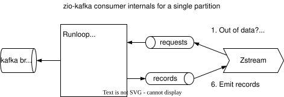

In this guide we tune a zio-kafka consumer for high throughput, low latency, low memory use, or slow processing. All tuning happens in `ConsumerSettings`; [Consumer Settings](consumer-settings.md) lists every setting with its default. We start from one of the two presets, adjust for record size and partition count, give slow processing enough time, and finally use zio-kafka's metrics to fine-tune pre-fetching.

## Don't Mix Up the Two Poll Settings

Two settings with similar names are involved in most tuning decisions:

- `pollTimeout` (zio-kafka) is how long one poll of the Kafka consumer may take.
- `max.poll.interval.ms` (Kafka) is the longest time allowed between two polls.

## Choose Between Throughput and Latency

The Kafka client can be tuned for either high throughput or low latency, unfortunately not both. The most important settings for tuning throughput and latency are:

- Zio-kafka's `pollTimeout` (`ConsumerSettings#withPollTimeout`) is the maximum time to block while polling the Kafka consumer. The default of 50 ms is good for low latency; set it higher, for example to 500 ms, for better throughput.
- Kafka's [`max.poll.records`](https://kafka.apache.org/documentation/#consumerconfigs_max.poll.records) (`ConsumerSettings#withMaxPollRecords`) is the maximum number of records a poll returns, 500 by default. Set it higher for more throughput, or lower for lower latency.
- Zio-kafka's `partitionPreFetchBufferLimit` (`ConsumerSettings#withPartitionPreFetchBufferLimit`): when a partition has at most this many records buffered, zio-kafka pre-fetches more records for it. The default, 1024, is twice the default `max.poll.records` of 500, rounded to the nearest power of 2.

Zio-kafka provides two presets that set these settings for the two common cases, `ConsumerSettings#tuneForHighThroughput` and `ConsumerSettings#tuneForLowLatency`. To start from one of them:

```scala mdoc:compile-only
import zio.kafka.consumer.ConsumerSettings

val bootstrapServers = List("localhost:9092")

val highThroughputSettings = ConsumerSettings(bootstrapServers).tuneForHighThroughput
val lowLatencySettings = ConsumerSettings(bootstrapServers).tuneForLowLatency
```

[Creating Settings](consumer-settings.md#creating-settings) lists the values each preset sets; they may change in later releases. Both presets replace the configured `FetchStrategy` with a `QueueSizeBasedFetchStrategy`, and so does `ConsumerSettings#withPartitionPreFetchBufferLimit`. Call them before `ConsumerSettings#withFetchStrategy`, otherwise a custom fetch strategy is silently discarded.

## Adjust for Small and Large Records

Kafka’s performance is not very sensitive to record size. However, when records become very small (< 100 bytes) it might be beneficial to increase `max.poll.records` and `partitionPreFetchBufferLimit`. Similarly, when records are very large (> 100Kb), `max.poll.records` can be decreased. Also, pre-fetching can be limited by decreasing `partitionPreFetchBufferLimit` or even disabled by using `ConsumerSettings#withoutPartitionPreFetching`.

## Limit Memory With Many Partitions

When a lot of partitions need to be consumed, we need to take into account that heap is needed to store the records in the partition queues. A very rough estimate for the maximum amount of heap needed is given by: `average record size` * `number of partitions` * max(`partitionPreFetchBufferLimit`, `max.poll.records`).

The total can be tuned by changing the `partitionPreFetchBufferLimit`, `max.poll.records` settings.

Another option is to use a different `FetchStrategy`, for example the built-in `zio.kafka.consumer.fetch.ManyPartitionsQueueSizeBasedFetchStrategy` (since zio-kafka 2.8.1), which also caps the total queue size over all partitions. When more partitions are eligible for pre-fetching than the total cap allows, it picks a random selection on every poll, so that no partition is starved:

```scala mdoc:compile-only
import zio.kafka.consumer.ConsumerSettings
import zio.kafka.consumer.fetch.ManyPartitionsQueueSizeBasedFetchStrategy

val settings = ConsumerSettings(List("localhost:9092"))
  .withFetchStrategy(
    ManyPartitionsQueueSizeBasedFetchStrategy(maxPartitionQueueSize = 1024, maxTotalQueueSize = 20480)
  )
```

You can also write a custom `FetchStrategy`, see [Writing a Custom Fetch Strategy](#writing-a-custom-fetch-strategy).

## Writing a Custom Fetch Strategy

A fetch strategy decides, before every poll, which partitions may receive records. It implements a single method:

```scala
package zio.kafka.consumer.fetch

trait FetchStrategy {
  def selectPartitionsToFetch(streams: Chunk[PartitionStream]): ZIO[Any, Nothing, Set[TopicPartition]]
}

abstract class PartitionStream {
  def tp: TopicPartition
  def queueSize: UIO[Int]
}
```

The consumer passes one `PartitionStream` for every partition stream that has not ended. `PartitionStream#tp` is the Kafka `TopicPartition` of the stream, and `PartitionStream#queueSize` is the number of records that are buffered for it and not yet pulled by your program. The consumer resumes the partitions in the returned set and pauses all other assigned partitions for the next poll.

A paused partition receives no records, even when its stream is waiting for them, so make sure every partition is selected again eventually. The built-in strategies select a partition whenever its queue size is at or below a limit, which always includes partitions with an empty queue. The method runs before every poll, so keep it fast.

The following strategy gives one topic a larger buffer than the others, so that its partitions keep more records ready:

```scala mdoc:compile-only
import org.apache.kafka.common.TopicPartition
import zio._
import zio.kafka.consumer.ConsumerSettings
import zio.kafka.consumer.fetch.{ FetchStrategy, PartitionStream }

final case class PriorityTopicFetchStrategy(
  priorityTopic: String,
  priorityLimit: Int = 4096,
  defaultLimit: Int = 256
) extends FetchStrategy {
  override def selectPartitionsToFetch(streams: Chunk[PartitionStream]): ZIO[Any, Nothing, Set[TopicPartition]] =
    ZIO
      .filter(streams) { stream =>
        val limit = if (stream.tp.topic() == priorityTopic) priorityLimit else defaultLimit
        stream.queueSize.map(_ <= limit)
      }
      .map(_.map(_.tp).toSet)
}

val settings: ConsumerSettings =
  ConsumerSettings(List("localhost:9092"))
    .withGroupId("orders-service")
    .withFetchStrategy(PriorityTopicFetchStrategy(priorityTopic = "payments"))
```

`PartitionStream` is part of the public API since zio-kafka 4.1.0; in earlier versions, a custom fetch strategy had to depend on an internal type.

## Long-Running Processes / Slow Consumers

To detect stalled consumers, Kafka removes a consumer from its group when it does not poll within the max poll interval ([`max.poll.interval.ms`](https://kafka.apache.org/documentation/#consumerconfigs_max.poll.interval.ms), 5 minutes by default), and assigns its partitions to other consumers.

In addition, a zio-kafka partition stream that has records waiting must pull them within the max stream pull interval (`ConsumerSettings#withMaxStreamPullInterval`), which defaults to `max.poll.interval.ms`. If it does not, zio-kafka fails the stream and shuts down the whole consumer.

To prevent both failures, decrease `max.poll.records` (so that time between polling gets shorter), and/or increase `max.poll.interval.ms` (so that the time between polls may be longer).

To decide whether your application needs a lower `max.poll.records` or a higher `max.poll.interval.ms`, we need to consider the maximum duration between polls. If processing is sequential, we can obtain this maximum by multiplying `max.poll.records` with the maximum duration to process a single record. To also accommodate things like long garbage collections and buffering, configuration `max.poll.interval.ms` should be substantially higher than the maximum processing time.

To let a consumer spend up to 15 minutes on a single record:

```scala mdoc:compile-only
import zio._
import zio.kafka.consumer.ConsumerSettings

val settings = ConsumerSettings(List("localhost:9092"))
  .withMaxPollRecords(1)
  .withMaxPollInterval(15.minutes)
  .withMaxStreamPullInterval(15.minutes)
```

Two more settings need attention when processing is slow.

### Slow Processing With Rebalance-Safe Commits

When rebalance-safe commits are enabled, a consumer must also process and commit a full poll of records within the max rebalance duration. [Size the Timeouts](preventing-duplicates.md#size-the-timeouts) shows how to calculate that budget.

### Quiet Topics and Silent Authorization Failure Detection

On topics with long idle periods, a low threshold for silent authorization failure detection (`ConsumerSettings#withEmptyPollCountToMetaRefresh`) triggers many offset-fetch requests. [Detect Silent Authorization Failures](detecting-authorization-failures.md#choose-a-threshold) explains how to choose the threshold.

## Using Metrics to Tune the Consumer

Zio-kafka exposes [metrics](metrics.md) that can be used to further tune the consumer. To interpret these metrics you need to know how zio-kafka works internally.



The runloop is at the heart of every zio-kafka consumer. It creates a stream for each partition, which is the stream your application eventually consumes from. When the stream starts, and every time its records queue is empty, it sends a request for data to the runloop. The request makes the runloop poll. Partitions whose queue size is at or below the `FetchStrategy`'s limit are resumed, so the next poll may receive records for them. Any received records are put in the records queue. When the queue reaches a certain size (as determined by the configured `FetchStrategy`), the partition is paused. Meanwhile, the stream reads from the queue and emits the records to your application.

An optimally configured consumer has the following properties:

- The streams never have to wait for new records, which gives high throughput.
- Most of the time, the record queues are empty, which gives low latency and low heap usage.

To get to this state, follow these steps:

1. First make sure that `pollTimeout` and `max.poll.records` make sense for the latency and throughput requirements of your application.
2. Configure `partitionPreFetchBufferLimit` to `0` (`ConsumerSettings#withPartitionPreFetchBufferLimit(0)`).
3. Observe metric `ziokafka_consumer_queue_polls` which gives the number of polls during which records are idling in the queue.
4. Increase `partitionPreFetchBufferLimit` in steps until most measurements of the `ziokafka_consumer_queue_polls` histogram are in the lowest bucket (`le="1.0"`; zio-metrics ignores the `0` bucket boundary, so this bucket counts both 0 and 1 idle polls).

During this process, it is useful to observe metric `ziokafka_consumer_queue_size` (number of records in the queues) to see if the queues are indeed increasing in size.

When many (hundreds of) partitions need to be consumed, the metric `ziokafka_consumer_all_queue_size` should also be observed as increasing `partitionPreFetchBufferLimit` can lead to high heap usage (see [Limit Memory With Many Partitions](#limit-memory-with-many-partitions)).
