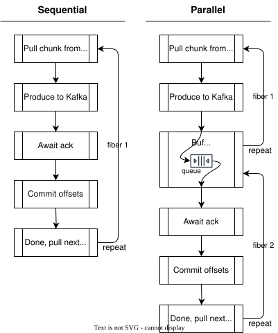

In this guide we build a zio-kafka program that consumes records, transforms them, produces the results to another topic and commits the consumed offsets, and then make it fast. We start with a simple, correct version, analyze where its time goes, and then let producing and committing run concurrently with consuming. The producer part also applies when you produce to Kafka from any other streaming source.

## Start With a Simple Program

This is what the program does:

1. consumes messages from topic `my-input-topic`,
2. transforms the received records,
3. produces the transformed records to topic `my-output-topic`,
4. commits the consumer offsets.

The program uses the zio-kafka streaming APIs, so it commits offsets explicitly: stream processing runs asynchronously from the consumer, so committing automatically is not possible. See [Offsets and Committing](offsets-and-committing.md) for the ways to commit, and [Producer](producer.md) for the producer API.

The application consumes, transforms, produces and commits in a single stream:

```scala mdoc:compile-only
import zio._
import zio.kafka.consumer._
import zio.kafka.producer._
import zio.kafka.serde._
import org.apache.kafka.clients.producer.ProducerRecord

val consumerSettings: ConsumerSettings =
  ConsumerSettings(List("localhost:9092")).withGroupId("my-application")
val producerSettings: ProducerSettings =
  ProducerSettings(List("localhost:9092"))

val app: ZIO[Scope, Throwable, Unit] = for {
  consumer <- Consumer.make(consumerSettings)
  producer <- Producer.make(producerSettings)
  _ <-
    consumer
      // Create a stream of records, consuming all records from a topic
      .plainStream(Subscription.topics("my-input-topic"), Serde.int, Serde.long)
      // Convert every record in a ProducerRecord, and the ConsumerRecord's offset
      .map { record =>
        val key: Int = record.record.key()
        val value: Long = record.record.value()
        val newValue: String = value.toString

        val producerRecord: ProducerRecord[Int, String] =
          new ProducerRecord("my-output-topic", key, newValue)
        (producerRecord, record.offset)
      }
      // For every chunk of producerRecords and offsets
      .mapChunksZIO { chunk =>
        val records = chunk.map(_._1)
        val offsetBatch = OffsetBatch(chunk.map(_._2))

        // produce the chunk of records, when acked by kafka, commit the consumed offsets,
        // returning an empty chunk (`mapChunksZIO` requires this function to return a ZIO[Chunk])
        producer.produceChunk(records, Serde.int, Serde.string) *>
          offsetBatch.commit.as(Chunk.empty)
      }
      .runDrain
} yield ()
```

## Analyze the Performance

To analyze throughput performance of a zio-streams program, it is important to find out the characteristics of the stream's chunks, and to make sure that the chunking structure stays intact. (See [Keep Stream Chunks Intact](avoiding-chunk-breakers.md).)

The program above uses a zio-kafka consumer as stream source. Kafka consumers poll the broker to get new records. Zio-kafka guarantees that all records that were received in a poll for a given partition, are in the same stream chunk. This is ideal; partitions can be processed in parallel, and we can process as many records as are available.

By default, the zio-kafka consumer does pre-fetching. The result is that as soon as the stream processed a chunk of records, the next chunk of records is already available. This increases throughput compared to having to wait for the next poll.

The next operation —`map`— keeps the chunking structure intact. Nothing to improve here.

The next operation —`mapChunksZIO`— also keeps the chunking structure intact. In this operator, we produce a chunk of records. Once they are acknowledged by the Kafka broker, we commit the offsets of the consumed records.

## Optimize Consumer Throughput

Let's zoom in on the consumer part of the example program.

Method `plainStream` produces a single stream, and chunks from different partitions are processed serially. At the cost of making the program more complex, we can increase throughput with per-partition parallel processing. See [Consuming With More Parallelism](consuming-kafka-topics-using-zio-streams.md#consuming-with-more-parallelism) for more details. On this page, we do not explore this optimization further.

Zio-kafka's prefetching automatically adapts and is usually as good as it can be. Only for very small/large records, or for large numbers of partitions, you may need to configure it better. See [Tune the Consumer](consumer-tuning.md) to find out how.

## Optimize Producer Throughput

:::caution[Know your domain]
The technique in this section keeps the order of records as long as every produce call succeeds, because the producer sends chunks in the order they were handed to it. When producing a chunk fails, the chunks after it may already have been written. When the producer retries records after an authorization error, those records may land after records of later chunks.
:::

Let's focus on the producer part of the program, that is, the `mapChunksZIO` operation in the example above. The operator pulls a chunk of records from upstream, produces that chunk to Kafka, awaits the acknowledgements, and then the process repeats. All these tasks are executed sequentially.

We can optimize throughput by pulling and producing the next chunk of records concurrently with waiting for the acknowledgements.

To implement this with zio-streams, we need to split the `mapChunksZIO` operation from the example above in separate stream operations:

1. produce the records
2. await the acknowledgements and commits offsets

We then use the `buffer` operator between those operations. Buffer allows upstream to run ahead in a separate fiber.

The following diagram compares the two approaches. The rectangles represent stream operations.



And now in code. The `mapChunksZIO` operator is replaced with the following operators. In this snippet, `stream` stands for the stream that the `map` step of the example application returns:

```scala mdoc:compile-only
import zio._
import zio.stream._
import zio.kafka.consumer._
import zio.kafka.producer._
import zio.kafka.serde._
import org.apache.kafka.clients.producer.ProducerRecord

val producer: Producer = ???
// The output of the `map` step in the example application
val stream: ZStream[Any, Throwable, (ProducerRecord[Int, String], Offset)] = ???

stream
  // Expose the chunking structure of the stream
  .chunks         // ZStream[_, _, Chunk[(ProducerRecord, Offset)]]

  // For every exposed chunk
  .mapZIO { chunk =>
    val records = chunk.map(_._1)
    val offsetBatch = OffsetBatch(chunk.map(_._2))
    // Produce asynchronously
    producer.produceChunkAsync(records, Serde.int, Serde.string)
      .map(await => (await, offsetBatch))
  }               // ZStream[_, _, (Task[Chunk[RecordMetadata]], OffsetBatch)]

  // Allow the producer to run ahead, producing up to 4 extra chunks
  .buffer(4)      // ZStream[_, _, (Task[Chunk[RecordMetadata]], OffsetBatch)]

  // Await acknowledgements for a chunk, and commit
  .mapZIO { case (await, offsetBatch) =>
    // 'await' is a ZIO, run it, and then commit offsets
    await *> offsetBatch.commit
  }               // ZStream[_, _, Unit]
```

Method `Producer#produceChunkAsync` returns a `RIO[R, Task[Chunk[RecordMetadata]]]`. The outer effect completes when the records have been enqueued in the producer's internal buffer. Completion gives us the inner task, which completes when the broker acknowledges the records.

In the code we use `buffer(4)` which allows the program to produce up to 4 extra chunk of records while awaiting acknowledgements.

When commits are not needed, we can simplify the code a bit:

```scala mdoc:compile-only
import zio.stream._
import zio.kafka.producer._
import zio.kafka.serde._
import org.apache.kafka.clients.producer.ProducerRecord

val producer: Producer = ???
val stream: ZStream[Any, Throwable, ProducerRecord[Int, String]] = ???

stream
  // Expose the chunking structure of the stream
  .chunks         // ZStream[_, _, Chunk[ProducerRecord]]
  // Every chunk gets produced asynchronously
  .mapZIO { records =>
    producer.produceChunkAsync(records, Serde.int, Serde.string)
  }               // ZStream[_, _, Task[Chunk[RecordMetadata]]]
  // Allow the producer to run ahead, producing up to 4 extra chunks
  .buffer(4)      // ZStream[_, _, Task[Chunk[RecordMetadata]]]
  // Await acknowledgements per chunk
  .flattenZIO     // ZStream[_, _, Chunk[RecordMetadata]]
```

## Optimize Committing

Committing offsets can become the bottleneck in highly optimized zio-kafka programs. This is because high commit rates can put a high strain on the broker. Next up, we split off committing to its own fiber as well by using `aggregateAsyncWithin`. See [Choose the Commit Rate](consuming-kafka-topics-using-zio-streams.md#choose-the-commit-rate) to learn how this works.

Replace the part after `ZStream#buffer` with the following operators. In this snippet, `buffered` stands for the stream that `buffer(4)` returns:

```scala mdoc:compile-only
import zio._
import zio.stream._
import zio.kafka.consumer._
import org.apache.kafka.clients.producer.RecordMetadata

// The output of `buffer(4)` in the previous section
val buffered: ZStream[Any, Throwable, (Task[Chunk[RecordMetadata]], OffsetBatch)] = ???

buffered
  // Await acknowledgements for a chunk
  .mapZIO { case (await, offsetBatch) =>
    // 'await' is a ZIO, run it, and then return the offsets
    await.as(offsetBatch)
  }                   // ZStream[_, _, OffsetBatch]
  .aggregateAsyncWithin(Consumer.collectOffsetBatches, Schedule.fixed(100.millis))
                      // ZStream[_, _, OffsetBatch]
  .mapZIO(_.commit)   // ZStream[_, _, Unit]
```

## Verify the Result

To check that each optimization pays off, run the program against a topic with a large backlog and compare the throughput before and after. The consumer's lag, shown by `kafka-consumer-groups.sh --describe --group my-application`, falls faster with the optimized program. With zio-kafka's [metrics](metrics.md), compare the producer's `ziokafka_producer_send_queue_size` and the consumer's `ziokafka_consumer_pending_commits` to see whether producing or committing is still the bottleneck.
