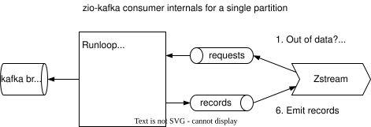
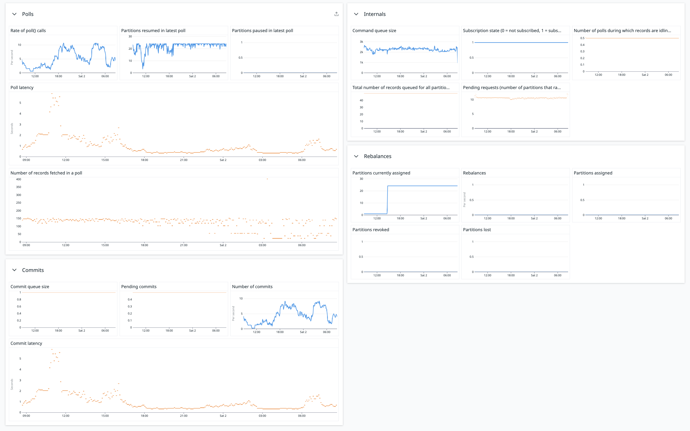
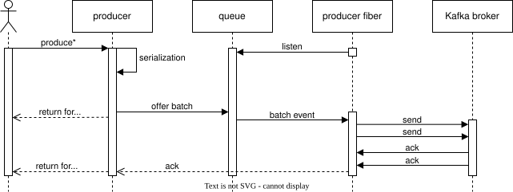

Zio-kafka exposes all the metrics of the wrapped Java consumer and producer, plus metrics about the zio-kafka consumer and producer themselves. This page lists both kinds and explains how to read them. To change where the zio-kafka metrics go, add labels, change histogram boundaries or turn the metrics off, see [Metrics Observers](metrics-observers.md).

## Java Client Metrics

`Consumer#metrics` and `Producer#metrics` return the metrics of the wrapped Java client as a `Task[Map[MetricName, Metric]]`, using Kafka's `org.apache.kafka.common.MetricName` and `Metric` classes. The map is a snapshot of the metrics that the client has registered at the time of the call; metrics that the client registers later, for example for a partition it is assigned afterwards, are missing from it. Each `Metric` in the map stays connected to the client: `Metric#metricValue` returns the current value every time you call it. To log the current value of every metric of a consumer:

```scala mdoc:compile-only
import zio._
import zio.kafka.consumer.Consumer

def logClientMetrics(consumer: Consumer): Task[Unit] =
  consumer.metrics.flatMap { metrics =>
    ZIO.foreachDiscard(metrics) { case (name, metric) =>
      ZIO.logDebug(s"${name.group()}/${name.name()} ${name.tags()}: ${metric.metricValue()}")
    }
  }
```

`AdminClient#metrics` does the same for the admin client, with zio-kafka's own `MetricName` and `Metric` types; see [Admin Client](admin-client.md). Zio-kafka does not copy the Java client metrics into ZIO metrics.

## Zio-kafka Metrics

The zio-kafka consumer and producer record additional metrics with the ZIO metrics API, so any ZIO metrics backend can access and export them. By default, they carry no labels; [Installing an Observer](metrics-observers.md#installing-an-observer) shows how to add them, which matters when an application runs several consumers or producers.

Like ZIO metrics, zio-kafka follows Prometheus conventions:

- Durations are expressed in seconds.
- Counters can only increase.
- Metric names use snake_case and end with the unit name where possible.

Each histogram has its own default bucket boundaries, mostly an exponential series based on 𝑒 that reaches a wide range while keeping accuracy at the low end. [Default Histogram Boundaries](metrics-observers.md#default-histogram-boundaries) lists them.

## Zio-kafka Consumer Metrics

To interpret the consumer metrics you need to know how the zio-kafka consumer works internally. The runloop polls the Java consumer and puts the fetched records in one queue per partition. Each partition stream takes records from its queue, and asks the runloop for more when the queue is empty. Commit requests go through a commit queue, and the runloop combines them into aggregated commits:



See [Using Metrics to Tune the Consumer](consumer-tuning.md#using-metrics-to-tune-the-consumer) for how to use these metrics to tune the consumer.

### Poll Metrics

The runloop updates these metrics after every poll:

| Type      | Name                                                  | Description                                                                        |
|-----------|-------------------------------------------------------|------------------------------------------------------------------------------------|
| counter   | `ziokafka_consumer_polls`                             | The number of polls.                                                               |
| histogram | `ziokafka_consumer_poll_latency_seconds`              | The duration of a single poll in seconds.                                          |
| histogram | `ziokafka_consumer_poll_size`                         | The number of records fetched by a single poll.                                    |
| gauge     | `ziokafka_consumer_partitions_resumed_in_latest_poll` | The number of partitions resumed in the latest poll call.                          |
| gauge     | `ziokafka_consumer_partitions_paused_in_latest_poll`  | The number of partitions paused in the latest poll call (because of backpressure). |
| counter   | `ziokafka_consumer_poll_auth_errors`                  | The number of polls that ended with an authentication or authorization error.      |

:::note
`ziokafka_consumer_poll_auth_errors` only counts errors that `poll()` itself throws. Some authorization failures, such as a revoked `READ` ACL, make `poll()` return no records without an error, so they do not increment this metric. To detect them, configure the empty-poll probe described in [Detect Silent Authorization Failures](detecting-authorization-failures.md).
:::

### Partition Stream Metrics

These metrics are sampled periodically, by default every 500ms (see `ConsumerSettings#withRunloopMetricsSchedule`):

| Type      | Name                                 | Description                                                            |
|-----------|--------------------------------------|------------------------------------------------------------------------|
| histogram | `ziokafka_consumer_pending_requests` | The number of partitions that ran out of records (the queue is empty). |
| histogram | `ziokafka_consumer_queue_size`       | The number of records queued for a partition.                          |
| histogram | `ziokafka_consumer_all_queue_size`   | The total number of records queued for all partitions.                 |
| histogram | `ziokafka_consumer_queue_polls`      | The number of polls during which records are idling in a queue.        |

### Commit Metrics

These metrics measure the separate commit requests issued through zio-kafka's API. `ziokafka_consumer_pending_commits` is sampled periodically, like the partition stream metrics:

| Type      | Name                                       | Description                                         |
|-----------|--------------------------------------------|-----------------------------------------------------|
| histogram | `ziokafka_consumer_pending_commits`        | The number of commits that are awaiting completion. |
| counter   | `ziokafka_consumer_commits`                | The number of commits.                              |
| histogram | `ziokafka_consumer_commit_latency_seconds` | The duration of a commit in seconds.                |

### Aggregated Commit Metrics

In each runloop cycle zio-kafka combines all outstanding commit requests into 1 aggregated commit. These metrics are for the aggregated commits:

| Type      | Name                                                  | Description                                                                |
|-----------|-------------------------------------------------------|----------------------------------------------------------------------------|
| counter   | `ziokafka_consumer_aggregated_commits`                | The number of aggregated commits.                                          |
| histogram | `ziokafka_consumer_aggregated_commit_latency_seconds` | The duration of an aggregated commit in seconds.                           |
| histogram | `ziokafka_consumer_aggregated_commit_size`            | An approximation of the number of records (offsets) per aggregated commit. |

### Rebalance Metrics

The runloop updates these metrics after each poll during which the partition assignment changed:

| Type    | Name                                              | Description                                                  |
|---------|---------------------------------------------------|--------------------------------------------------------------|
| counter | `ziokafka_consumer_rebalances`                    | The number of rebalances.                                    |
| gauge   | `ziokafka_consumer_partitions_currently_assigned` | The number of partitions currently assigned to the consumer. |
| counter | `ziokafka_consumer_partitions_assigned`           | The number of partitions assigned to the consumer.           |
| counter | `ziokafka_consumer_partitions_revoked`            | The number of partitions revoked from the consumer.          |
| counter | `ziokafka_consumer_partitions_lost`               | The number of partitions lost by the consumer.               |

### Runloop Metrics

These metrics are sampled periodically, by default every 500ms (see `ConsumerSettings#withRunloopMetricsSchedule`):

| Type      | Name                                   | Description                                        |
|-----------|----------------------------------------|----------------------------------------------------|
| gauge     | `ziokafka_consumer_subscription_state` | Whether the consumer is subscribed (1) or not (0). |
| histogram | `ziokafka_consumer_command_queue_size` | The number of commands queued in the consumer.     |
| histogram | `ziokafka_consumer_commit_queue_size`  | The number of commits queued in the consumer.      |

[Metric Descriptors](metrics-observers.md#metric-descriptors) maps every consumer metric to its field in `ConsumerMetrics`.

## Example Dashboard

The dashboard below shows the consumer metrics of one application over a day, grouped into polls, commits, runloop internals and rebalances. It shows, for example, the poll rate next to the poll latency and the number of records per poll, the size of the command queue, and the moment the consumer got its partitions assigned:



## Zio-kafka Producer Metrics

To understand the producer metrics it helps to know how the producer works. Every produce call serializes its records and offers them as one batch (a single record is a batch of one) to an internal send queue. A background fiber takes the batches from the queue and sends their records to the Kafka broker, which acknowledges them. See [Producer](producer.md) for the details:



### Producer Metrics

These metrics are only updated for produce calls in which every record was produced successfully:

| Type      | Name                                | Description                                                                             |
|-----------|-------------------------------------|-----------------------------------------------------------------------------------------|
| counter   | `ziokafka_producer_calls`           | The number of produce calls that completed successfully.                                |
| histogram | `ziokafka_producer_latency_seconds` | The duration of a single produce, from after serialization to acknowledged, in seconds. |
| counter   | `ziokafka_producer_records`         | The number of records produced.                                                         |
| histogram | `ziokafka_producer_batch_size`      | The number of records per produce call.                                                 |

### Queue Metrics

The send queue metrics show whether the send fiber keeps up with the produce calls:

| Type      | Name                                           | Description                                                                                  |
|-----------|------------------------------------------------|----------------------------------------------------------------------------------------------|
| histogram | `ziokafka_producer_send_queue_size`            | The number of batches (produce calls) in the zio-kafka send queue, sampled every 10 seconds. |
| histogram | `ziokafka_producer_send_queue_latency_seconds` | Time in send queue, including waiting for capacity, in seconds.                              |

The capacity of the send queue is set with `ProducerSettings#withSendBufferSize`.

### Send Metrics

The producer counts the sends that the broker rejected for security reasons:

| Type    | Name                            | Description                                                                           |
|---------|---------------------------------|---------------------------------------------------------------------------------------|
| counter | `ziokafka_producer_auth_errors` | The number of record sends that resulted in an authentication or authorization error. |

[Metric Descriptors](metrics-observers.md#metric-descriptors) maps every producer metric to its field in `ProducerMetrics`.
